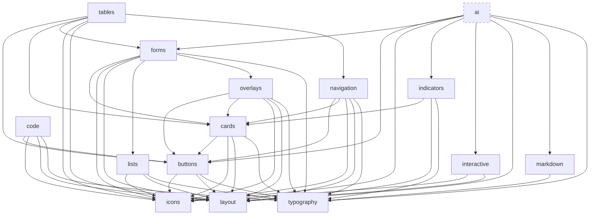

# Component Dependency Graph

Which UIID UI packages rely on other UI packages. An arrow `A --> B` means "A imports from B (value or type) in shipped source". Derived from the `@uiid/*` imports in each package's `src`, not from `package.json`, so a declared dependency that nothing imports does not show up here.

Test, example, story, and mock files (`*.test.tsx`, `*.examples.tsx`, `*.stories.tsx`, `*.mocks.ts(x)`) are excluded, since they never ship. Non-visual packages (`tokens`, `utils`) and the `design-system` barrel are excluded too — this is only the UI component library.

`layout`, `typography`, and `icons` are the primitives; they get the most incoming arrows because almost everything is built on them.



## Notes

- Cycle-free. `cards` uses `buttons` (CollapsibleCard's trigger), `overlays` uses `buttons` and `cards`, and nothing points back up: `buttons` depends only on the primitives.
- `layout`, `typography`, and `icons` are leaves — they rely on no other UI package. (`layout` composes shared text styles from `@uiid/tokens`, so it does not depend on `typography`.)
- `markdown` is the lightest non-leaf, reaching only `typography`. `interactive` reaches only `icons` and `layout`.
- `ai` is private and not re-exported from the barrel, so it is drawn with a dashed border.
- To regenerate, run this from the repo root. It lists each package's `@uiid/*` imports in shipped source, skipping the `design-system`, `tokens`, and `utils` packages and dropping `tokens`, `utils`, and the package itself from each row:

  ```sh
  for p in packages/*/src; do
    pkg=$(basename "$(dirname "$p")")
    case "$pkg" in design-system | tokens | utils) continue ;; esac
    echo "$pkg: $(grep -rhoE "[\"']@uiid/[a-z-]+" "$p" \
      --include='*.ts' --include='*.tsx' --include='*.css' \
      --exclude='*.test.*' --exclude='*.examples.*' --exclude='*.stories.*' --exclude='*.mocks.*' \
      | sed -E "s/.*@uiid\///" | sort -u | grep -vxE "tokens|utils|$pkg" | tr '\n' ' ')"
  done
  ```
